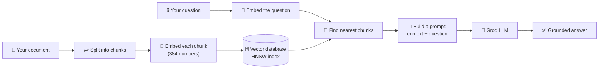
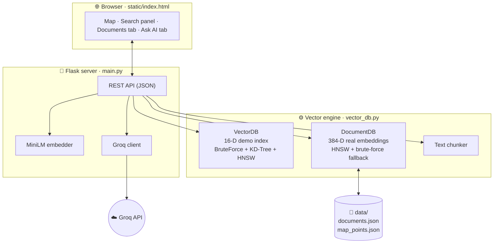

<div align="center">

# 🧠 yourOwnAi

### Teach an AI your own documents — and watch it find the answer on a live map.

A **RAG (Retrieval-Augmented Generation)** app powered by a **vector database written from scratch in Python**.
Paste in your notes, ask a question, and see exactly which piece of text the AI used to answer.


<br>


</div>

---

## Table of Contents

1. [What is this?](#what-is-this)
2. [Features](#features)
3. [How it works](#how-it-works)
4. [The ideas behind it, in plain English](#the-ideas-behind-it-in-plain-english)
5. [Architecture](#architecture)
6. [Tech stack](#tech-stack)
7. [Getting started](#getting-started)
8. [Using the app](#using-the-app)
9. [Experiments to try](#experiments-to-try)
10. [API reference](#api-reference)
11. [Project structure](#project-structure)
12. [Configuration](#configuration)
13. [Design decisions](#design-decisions)
14. [Troubleshooting](#troubleshooting)
15. [Limitations](#limitations)
16. [Roadmap](#roadmap)
17. [License](#license)

---

## What is this?

Large language models know a lot, but they don't know **your** documents, and when they don't know something they sometimes make it up. That is called **hallucination**.

**yourOwnAi** fixes this with **Retrieval-Augmented Generation (RAG)**:

1. You give the app your own text (notes, articles, anything).
2. When you ask a question, the app first **searches your text** for the most relevant parts.
3. Those parts are handed to an LLM, which writes an answer **based on them**.

The core of the project is the search step. Instead of calling a ready-made vector database, `yourOwnAi` **implements one from scratch**: the storage, the distance maths, and three different search algorithms (Brute Force, KD-Tree and HNSW). A live 2D map lets you *see* the search happening: your question appears as a star, and it lands next to the document that matches its meaning.

> **The key idea:** whatever is closest to your question in the database steers the answer. Change the documents, and you change what the AI says.

---

## Features

- 🔎 **Semantic search.** Finds text by *meaning*, not just matching words. A search for "small dog" can find a document about a puppy.
- 🤖 **Grounded answers.** Answers are written by an LLM (Groq) using the text it just retrieved from your documents.
- 🗺️ **Live semantic map.** A 2D projection shows every stored point, your question as a glowing star, animated lines to the best matches, and labels for the top results.
- ⚙️ **Three search algorithms.** Compare Brute Force, KD-Tree and HNSW side by side, with three distance metrics (cosine, Euclidean, Manhattan) and a built-in timing benchmark.
- ✂️ **Automatic chunking.** Long documents are split into overlapping chunks, and each chunk is embedded and searched separately.
- 💾 **Saved between runs.** Documents are stored on disk and reloaded when the server restarts. The search index is rebuilt automatically.
- 🛡️ **Safe by design.** All text from the server is escaped before it is shown, API errors are returned cleanly, and secrets stay in a git-ignored `.env` file.
- 🔍 **Transparent.** Every answer shows the exact chunks it was built from, with their distance scores.

---

## How it works

Every question goes through five steps:



1. **Ingest.** Your text is split into chunks of about 250 words, with a 30-word overlap so no sentence is cut in half and lost.
2. **Embed.** Each chunk is converted by `all-MiniLM-L6-v2` into a list of 384 numbers, called a *vector* or *embedding*. Texts with similar meaning get similar numbers.
3. **Store.** The vectors go into the from-scratch vector database and are also saved to `data/documents.json`.
4. **Retrieve.** Your question is embedded the same way. The database finds the stored chunks closest to it (cosine distance) using an HNSW graph.
5. **Generate.** The closest chunks and your question are placed into a prompt, and Groq's `openai/gpt-oss-120b` model writes the answer.

---

## The ideas behind it, in plain English

### Embeddings: turning meaning into coordinates

Computers don't understand words, but they are good at numbers. An *embedding model* reads a piece of text and outputs a list of numbers, which you can think of as **coordinates on a map of meaning**.

A simple analogy: rate foods by sweetness and crunchiness.

| Food | Sweetness | Crunchiness | Coordinates |
|---|---|---|---|
| Apple | 8 | 7 | (8, 7) |
| Cake | 10 | 2 | (10, 2) |
| Potato chips | 1 | 10 | (1, 10) |

Ask for "a little sweet and a little crunchy" and that becomes the point (5, 5). The closest food on the map is the apple. Real embeddings do exactly this, but with **384 dimensions** instead of 2, so they can capture far more than sweetness and crunch.

### Distance: how "close" is close?

Once everything is a point, "most similar" means "nearest". This project supports three ways to measure distance:

| Metric | What it measures |
|---|---|
| **Cosine** | The angle between two vectors. Used for documents, because it compares *direction* (meaning) and ignores length. |
| **Euclidean** | The straight-line distance between two points. |
| **Manhattan** | The distance if you could only move along the grid, one axis at a time. |

### Three ways to find the nearest point

| Algorithm | How it works | Trade-off |
|---|---|---|
| **Brute Force** | Measure the distance to *every* stored point, then sort. | Always exact, but gets slow as data grows. |
| **KD-Tree** | Like a game of 20 questions: repeatedly split the space in half, and skip whole regions that can't contain the answer. | Fast in low dimensions, but loses its advantage as the number of dimensions grows. |
| **HNSW** | Builds a layered "small world" graph of connected points. The search takes long jumps across the top layers, then refines locally on the bottom layer, like using highways before local streets. | Very fast and scales well, but approximate. It is the standard choice for high-dimensional embeddings. |

The 384-dimensional document embeddings use HNSW (with brute force when there are fewer than 10 chunks). The 16-dimensional demo data uses all three so you can compare them.

### Steering the AI

Because the answer is built from whatever chunk is nearest to the question, **you control the AI by controlling the database**. Insert a document that says AI is dangerous, ask "is AI dangerous?", and the answer shifts toward your text.

---

## Architecture



**Why two databases?**

- **`DocumentDB`** is the real one. It stores the 384-dimensional embeddings of your documents and powers the *Ask AI* answers.
- **`VectorDB`** is a 16-dimensional playground with 20 built-in items (computer science, maths, food, sports). It exists so you can watch and compare all three algorithms, and it also holds the points drawn on the map.

**Why is `vector_db.py` separate from `main.py`?** The engine has no web code in it. It can be tested, reused, or swapped into a different app without touching Flask.

---

## Tech stack

| Layer | Technology |
|---|---|
| Language | Python 3.10+ (developed on 3.13) |
| Web server | Flask, Flask-CORS |
| Vector maths | NumPy |
| Embeddings | `sentence-transformers` with `all-MiniLM-L6-v2` (384 dimensions) |
| LLM | Groq API with `openai/gpt-oss-120b` |
| Frontend | HTML, CSS, vanilla JavaScript, Canvas API (the 2D projection is computed in the browser with PCA) |
| Config | `python-dotenv` |
| Packages | `uv` |

---

## Getting started

### Prerequisites

- **Python 3.10 or newer**
- **[uv](https://docs.astral.sh/uv/)**, a fast Python package manager
- **A free Groq API key:** create one at [console.groq.com](https://console.groq.com/) under *API Keys*
- About **1 GB of free disk space** (the embedding library `torch` is large)

### Installation

```bash
# 1. Clone the repository
git clone https://github.com/YOUR-USERNAME/yourOwnAi.git
cd yourOwnAi

# 2. Install all dependencies into a virtual environment
uv sync
```

### Add your API key

Copy the template and edit it:

```bash
# macOS / Linux
cp .env.example .env

# Windows PowerShell
Copy-Item .env.example .env
```

Open `.env` and set your key:

```
GROQ_API_KEY=your_groq_api_key_here
```

> 🔒 `.env` is listed in `.gitignore`, so your key is never committed.

### Run it

```bash
uv run main.py
```

Wait for this message in the terminal:

```
=== VectorDB Engine ===
http://localhost:8080
```

Then open **http://localhost:8080** in your browser.

> ⏳ **The first start is slower.** It downloads the embedding model (about 90 MB). After that it starts in a few seconds.

---

## Using the app

The screen has three areas: **controls on the left**, **the semantic map in the middle**, and **three tabs on the right**.

### 1. Documents tab: give the AI knowledge

1. Enter a **title** and paste your **text**.
2. Click **Embed & Insert**.
3. The status line reports how many chunks were created and the embedding size (384).

Inserted documents appear in the list below and show up as dots on the map. They stay saved when you restart the server.

### 2. Ask AI tab: question your documents

1. Type a question and choose how many chunks to retrieve (Top 2, 3 or 5).
2. Click **Ask AI** (or press `Ctrl + Enter`).
3. Read the answer, then click the **context chips** underneath to see the exact text each chunk contributed and how close it was (smaller distance means a better match).

On the map, the **star** is your question, the **dashed lines** connect it to the matching chunks, and the matched dots pulse.

### 3. Search panel: compare the algorithms

The left panel runs a search over the built-in 16-dimensional demo data.

- Type a word such as `binary tree`, `sushi`, `basketball` or `calculus`.
- Pick the algorithm (**HNSW**, **KD-Tree** or **Brute**), the distance metric and how many results you want.
- The right-hand **Search** tab shows the latency and the nearest matches.
- Click **Compare all algos** to time the three algorithms on the same query.

> ℹ️ This demo panel recognises a fixed list of keywords. It illustrates how the algorithms behave. The real meaning-based search is the **Ask AI** path.

---

## Experiments to try

### 🧪 1. Steer the AI

1. Ask: `is ai dangerous`. You get a balanced, general answer.
2. Insert a document titled `AI Danger` containing a strongly one-sided claim about AI being dangerous.
3. Ask the same question again. The answer moves toward your text, and `AI Danger` appears as a retrieved chunk.

### 🧪 2. Prove it uses *your* data

Insert a document that states something false, for example that the Eiffel Tower is in Rome. Ask "Where is the Eiffel Tower?" and the answer follows your document. This shows the answer comes from the retrieved text, not only from the model's memory.

### 🧪 3. Ask about something the model cannot know

Ask `What is the secret password of the Zorblax Garden Club?` with an empty database. The model can only guess or say it doesn't know. Insert a document containing the password, ask again, and it answers correctly with the source chunk shown.

### 🧪 4. Test the chunker

Paste a document of 600 words or more. The status line reports several chunks, and the chunk titles look like `My Notes [2/3]`.

### 🧪 5. Restart test

Insert a document, stop the server with `Ctrl + C`, start it again, and refresh. Your document is still there.

---

## API reference

All endpoints return JSON. The server runs on port `8080`.

### Documents and RAG

| Method | Endpoint | Description |
|---|---|---|
| `POST` | `/doc/insert` | Chunk, embed and store a document |
| `POST` | `/doc/ask` | Full pipeline: embed, retrieve, prompt, generate |
| `POST` | `/doc/search` | Retrieval only (no LLM call) |
| `GET` | `/doc/list` | List stored chunks with a short preview |
| `DELETE` | `/doc/delete/<id>` | Remove one stored chunk |

**Insert a document**

```http
POST /doc/insert
Content-Type: application/json

{ "title": "Moon facts", "text": "The Moon orbits the Earth about every 27 days." }
```

```json
{ "ids": [1], "chunks": 1, "dims": 384 }
```

**Ask a question**

```http
POST /doc/ask
Content-Type: application/json

{ "question": "How long does the Moon take to orbit the Earth?", "k": 3 }
```

```json
{
  "answer": "About 27 days.",
  "model": "openai/gpt-oss-120b",
  "contexts": [
    { "id": 1, "title": "Moon facts", "text": "The Moon orbits ...", "distance": 0.2314 }
  ],
  "docCount": 1
}
```

Errors are returned as `{ "error": "message" }`.

### Demo vectors and the map

| Method | Endpoint | Description |
|---|---|---|
| `GET` | `/search?v=...&k=5&metric=cosine&algo=hnsw` | k-nearest-neighbour search on the 16-D demo data |
| `GET` | `/benchmark?v=...&k=5&metric=cosine` | Time all three algorithms on one query |
| `GET` | `/items` | All demo vectors (used to draw the map) |
| `POST` | `/insert` | Add a 16-D vector |
| `DELETE` | `/delete/<id>` | Remove a 16-D vector |
| `GET` | `/hnsw-info` | Nodes and edges per HNSW layer |
| `GET` | `/status` | Models, document count and embedding size |
| `GET` | `/stats` | Demo index summary |

`algo` is one of `hnsw`, `kdtree` or `bruteforce`. `metric` is one of `cosine`, `euclidean` or `manhattan`.

---

## Project structure

```
yourOwnAi/
├── main.py              # Flask server: routes, embedding, Groq call
├── vector_db.py         # The vector database engine (no web code)
├── static/
│   └── index.html       # The interface: map, panels, chat
├── docs/
│   └── screenshot.png   # Screenshot used in this README
├── data/                # Saved documents (auto-created, git-ignored)
│   ├── documents.json
│   └── map_points.json
├── .env.example         # Template for your API key
├── .gitignore
├── pyproject.toml       # Dependencies
├── uv.lock              # Exact dependency versions
└── README.md
```

### What's inside `vector_db.py`

| Part | Purpose |
|---|---|
| Distance functions | `euclidean`, `cosine`, `manhattan` (NumPy) |
| `BruteForce` | Exact search over all items |
| `KDTree` | Insert, pruned k-nearest-neighbour search, rebuild on delete |
| `HNSW` | Layered graph with random level assignment, neighbour selection and pruning, search and removal |
| `VectorDB` | The 16-D demo index with a lock, search, benchmark and graph statistics |
| `DocumentDB` | The 384-D document store with persistence |
| `chunk_text` | Overlapping word-based chunker |
| `DEMO_DATA` | The 20 built-in demo vectors across four subjects |

---

## Configuration

Settings are constants at the top of each file.

**`vector_db.py`**

| Constant | Default | Meaning |
|---|---|---|
| `HNSW_M` | `16` | Maximum connections per node in the HNSW graph |
| `HNSW_EF_BUILD` | `200` | Candidate list size while building the graph (higher is better quality, slower) |
| `HNSW_EF_SEARCH` | `50` | Candidate list size while searching (higher is more accurate, slower) |
| `HNSW_SEED` | `42` | Random seed, so the graph is reproducible |
| `DOC_BRUTE_FORCE_LIMIT` | `10` | Below this many chunks, use exact brute-force search |
| `DOC_MAX_DIST` | `0.7` | Chunks with a cosine distance above this are ignored |
| `CHUNK_WORDS` | `250` | Words per chunk |
| `CHUNK_OVERLAP_WORDS` | `30` | Words shared by neighbouring chunks |

**`main.py`**

| Constant | Default | Meaning |
|---|---|---|
| `EMBED_MODEL_NAME` | `all-MiniLM-L6-v2` | Embedding model |
| `GEN_MODEL_NAME` | `openai/gpt-oss-120b` | Groq model used for answers |
| `HOST` / `PORT` | `0.0.0.0` / `8080` | Where the server listens |
| `DEFAULT_DOC_K` | `3` | Chunks retrieved per question |

**Environment variable (`.env`)**

| Variable | Required | Meaning |
|---|---|---|
| `GROQ_API_KEY` | ✅ | Your Groq API key |

> 💡 The embedding model reads roughly the first 256 tokens of each chunk. If your answers seem to miss details at the end of long chunks, lower `CHUNK_WORDS` to about `150`.

---

## Design decisions

**Why build the vector database from scratch?**
Using a hosted vector database hides how search really works. Writing it by hand shows what happens under the hood: how vectors are compared, why brute force becomes slow, and how HNSW trades a little accuracy for a lot of speed.

**Why HNSW for documents?**
Real embeddings have hundreds of dimensions. KD-Trees degrade badly in that range, while HNSW is built for it. The 16-D demo index keeps all three algorithms so the difference can be measured.

**Why cosine distance?**
Cosine compares direction, not length, which is how sentence embeddings are meant to be compared.

**Why fall back to brute force for small collections?**
With fewer than 10 chunks an exact search costs almost nothing and removes any approximation error.

**Why keep documents and map points in separate files?**
The real embeddings (384 dimensions) and the display points (16 dimensions) serve different purposes. Keeping them apart means the map can change without touching the AI's memory.

**How is data saved safely?**
Every save writes to a temporary file first and then swaps it in atomically, so a crash can't leave a half-written file. If a saved file is unreadable, it is moved aside as `.bad` and the app starts empty. If the saved data came from a different embedding model, it is ignored, because vectors from different models can't be compared.

**Why Groq and MiniLM?**
Groq gives fast answers from a large model with a free tier. MiniLM is small, runs on a normal CPU, and needs no API key for embeddings.

---

## Troubleshooting

| Problem | Likely cause and fix |
|---|---|
| `ModuleNotFoundError: No module named 'flask'` | Dependencies aren't installed. Run `uv sync`, then start with `uv run main.py`. |
| `ValueError: GROQ_API_KEY not found in .env file` | Create `.env` in the project folder with `GROQ_API_KEY=...`. |
| Page shows "Connecting…" or the badge says `SERVER ✗` | The server isn't running, or it crashed. Check the terminal for the error. |
| Port 8080 already in use | Close the other program using it, or change `PORT` in `main.py` and `API` at the top of the script in `static/index.html`. |
| First start takes a long time | The embedding model is downloading (about 90 MB). This only happens once. |
| A question returns no context chunks | The best match was farther than `DOC_MAX_DIST` (0.7). Raise it slightly, for example to `0.8`. |
| Unrelated chunks keep appearing | Lower `DOC_MAX_DIST`. |
| The answer ignores your document | The model preferred its own knowledge for a very well-known fact. Check that the chunk appears in the context chips. If it does, retrieval worked. |
| Error message mentioning Groq | Check your API key, your internet connection and Groq's rate limits. |
| Documents disappear after restart | Make sure the `data/` folder is writable and that you didn't change `EMBED_MODEL_NAME` (a different model makes saved data unusable, and a warning is printed). |

---

## Limitations

Being clear about what this project is, and isn't:

- **It is a learning and demonstration project,** not a production vector database. Everything runs in one process, and the index is rebuilt in memory at startup. For large-scale use, a dedicated database such as Qdrant or pgvector is the right tool.
- **The left-panel search is not semantic.** It converts text to a 16-dimensional vector with a keyword list, so it only recognises its built-in words. Meaning-based search is the Ask AI path.
- **Document positions on the map are approximate.** Documents are drawn using a 16-dimensional stand-in vector, not their real 384-dimensional embeddings.
- **The KD-Tree's pruning rule is only exact for Euclidean and Manhattan distance.** With cosine distance it can occasionally miss the true nearest neighbour.
- **HNSW deletion removes a node's links but doesn't repair its neighbours,** so heavy deleting can weaken the graph.
- **The model may mix sources.** If the retrieved text isn't relevant, the LLM falls back on its own knowledge. There is no strict "answer only from the documents" mode yet.
- **No authentication.** The server listens on all network interfaces by default. For local-only use, set `HOST = "127.0.0.1"` in `main.py`.

---

## Roadmap

- [ ] Benchmark HNSW against brute force on thousands of vectors, with recall measurements
- [ ] Draw the map from the real 384-dimensional embeddings
- [ ] Strict mode: answer only from the retrieved documents
- [ ] Upload PDF and text files
- [ ] Stream answers token by token
- [ ] Automated tests that check the three algorithms agree
- [ ] Repair HNSW neighbours on delete, and exact pruning for cosine in the KD-Tree

---

## License

Add a `LICENSE` file to the repository (for example, MIT) and update this section to match.

---

<div align="center">

**Built by [YOUR NAME](https://github.com/YOUR-USERNAME)**

If you found this useful, a ⭐ on the repository is appreciated.

</div>